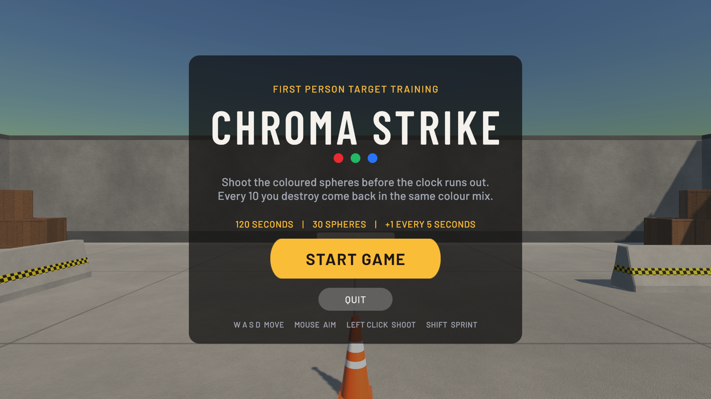
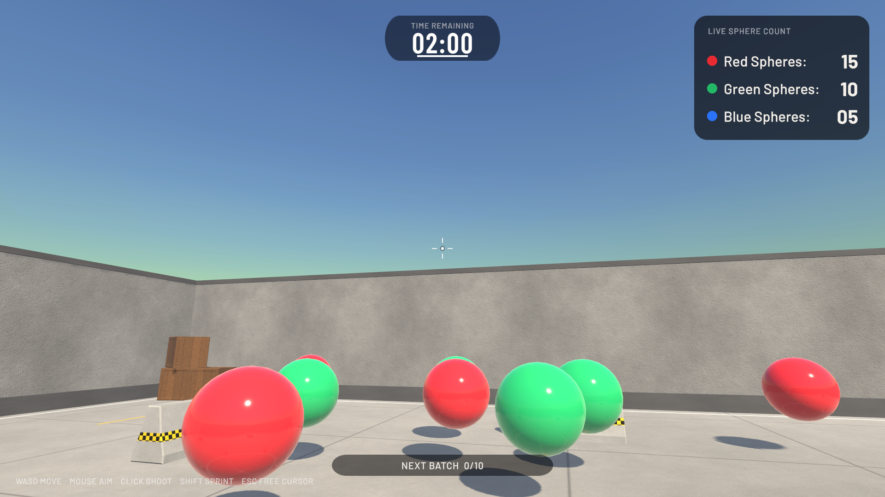
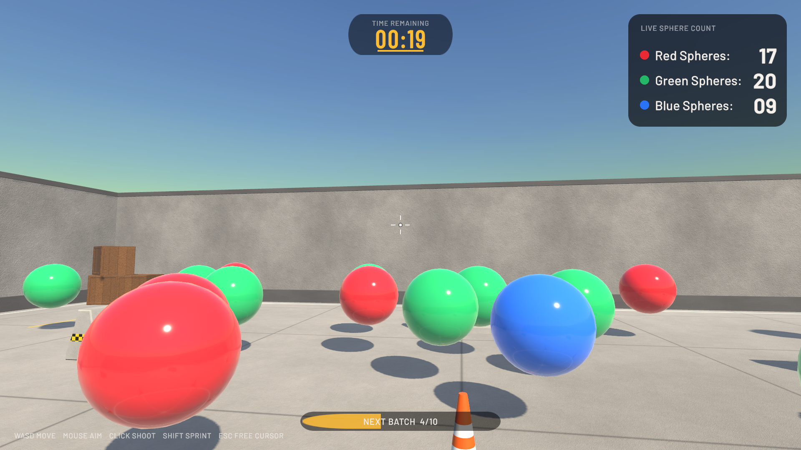
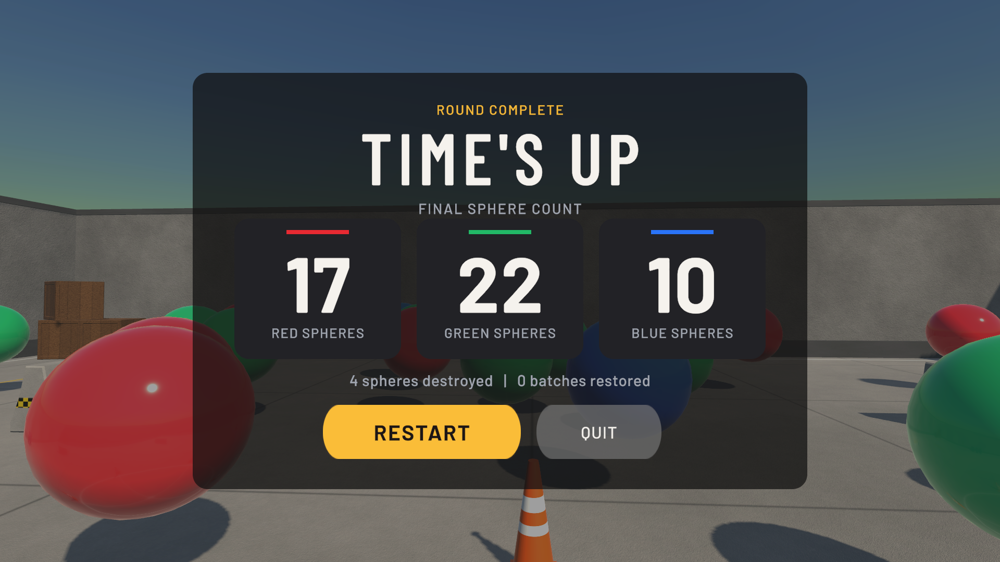

# Task 1 - Chroma Strike

## Open the delivered ZIP - updated 2 November 2026

Extract the **entire ZIP** to a short local folder such as `C:\UnityAssignment`. The combined ZIP contains separate `Task1` and `Task2` project folders. Do not run from inside the ZIP.

- **Play without Unity:** double-click `PLAY.cmd` inside this task folder. It finds the bundled Windows player relative to itself, even if the folder is moved. Keep the complete `Builds/Windows` folder, including its `_Data` folder and `UnityPlayer.dll`.
- **Install:** use the setup EXE in `Installer`; this is an alternative to the portable player.
- **Edit source:** Unity Hub > Add project from disk > choose this task folder containing `Assets`, `Packages`, and `ProjectSettings`. Use **6000.6.7f1** with an activated Editor license. First import needs internet to restore registry packages. Open the supplied scene; do not regenerate it.
- **Watch locally:** the owner-provided MP4 is in `Docs`. No YouTube or Google Drive access is required after downloading this ZIP.
- **Diagnose a launch problem:** `PLAY.cmd` writes the player log to `%TEMP%/Task1-Player.log`. Report the first error and the exact action that failed.

A first-person sphere-targeting game built in Unity. Move around a flat arena, aim with the mouse, and pop color-coded spheres during a 120-second round. The live counters show the spheres remaining, not the cumulative number destroyed.

## Release status - 1 November 2026

Unity verification completed: **7 EditMode tests + 5 PlayMode gameplay tests passed**, and the screenshot walkthrough passed. The current Windows player built successfully with **zero build errors and zero warnings**. Start/gameplay/end UI was rendered and reviewed, and the five documentation screenshots were refreshed from the current scene.

The Windows installer is generated from this player using the included Inno Setup recipe. See [requirement coverage](Docs/REQUIREMENTS.md), [validation report](Docs/VALIDATION.md), and [repeatable testing instructions](Docs/TESTING.md).

## Setup and controls

1. Activate your Unity license in Unity Hub and open this folder using **Unity 6000.6.7f1** with Windows Build Support.
2. Allow packages to restore, then open `Assets/Scenes/Game.unity`.
3. Press Play and select **Start Game**. Click the Game view if input focus is elsewhere.
4. Use **WASD** to move, **Mouse** to aim, **Left Mouse** to pop the sphere under the center reticle, and **Shift** to sprint.
5. **Escape** releases the cursor. Click the game view to resume aiming. The countdown continues.
6. At time-up, inspect the final red, green and blue counts. Select **Restart** for a fresh round or **Quit** to exit.

The Windows build is `Builds/Windows/Chroma Strike.exe`. Its entire directory is required. The installer is `Installer/ChromaStrike-Setup-1.0.0.exe`.

## Gameplay rules

- The Start screen includes the game title and Start button.
- Starting creates exactly **30 spheres: 15 red, 10 green and 5 blue**.
- Spawn centers use **X/Z between -10 and 10, Y = 1**.
- Placement checks occupied sphere positions, player clearance and obstacle colliders. When crowded, requests wait for a free position instead of overlapping an existing object.
- Every **5 seconds**, one randomly chosen red, green or blue sphere is added and updates the live count.
- Every **10 destroyed spheres** immediately requests a replacement batch with the same color counts. For example, destroying 5 red, 2 green and 3 blue produces a 5-2-3 batch. The next group starts counting from zero.
- Left-click casts a ray from the camera center. A sphere is popped only when that ray hits it; obstacles can block shots.
- The timer is top-center and the live color counters are top-right.
- At **120 seconds**, shooting, movement, physics and spawn retries stop. The end screen shows final live counts and a Restart button.
- Restart resets the player, timer, counts and batch history and creates a fresh 15/10/5 distribution.

## Project structure and key classes

- `Core/GameManager`: starts/ends/restarts the round and coordinates input, timer, spawner and UI events.
- `Core/GameConfig`: Inspector-editable spawn bounds, initial mix, duration, intervals, movement and shooting settings.
- `Core/CountdownTimer`, `RepeatingTimer`: deterministic countdown and recurring event timing, including long-frame catch-up.
- `Spheres/SpawnerManager`: initial, timed and conditional spawning; live/destroyed counts; queued placement retries.
- `Spheres/SpawnPointFinder`: random placement and sphere/player/obstacle clearance checks.
- `Spheres/BatchTracker`, `ColorTally`, `SphereColor`: destroyed color accounting and batch composition.
- `Spheres/Sphere`: sphere appearance, hover and destruction feedback.
- `Player/PlayerInputReader`, `FirstPersonController`: Input System actions, movement and mouse look.
- `Player/ClickHandler`, `CursorController`: center-ray selection and cursor ownership.
- `UI/UIManager`, `CounterRow`, `TimerView`, `BatchProgressView`, `ToastView`: menu/HUD/results and feedback.
- `Feedback/AudioService`, `FeedbackController`, `PopEffectPlayer`: sounds and pop particles.
- `Editor/SceneBuilder`, `BuildCommands`, `ProjectSetup`: scene construction, player settings and Windows build.

Game balancing is configured in `Assets/Settings/GameConfig.asset`. UI layouts and generated environment geometry are in the scene builder. Runtime scripts are separated by responsibility and communicate using events where appropriate.

## Unity and packages

- Unity **6000.6.7f1**, recorded in `ProjectSettings/ProjectVersion.txt`.
- Input System **1.20.1**.
- Universal Render Pipeline **17.6.0**.
- uGUI / TextMesh Pro **2.0.0**.
- Unity Test Framework **1.4.6**.

`Packages/manifest.json` and `packages-lock.json` record dependencies. The build uses the new Input System.

## Build and installer

After license activation, run `Tools/Run-Checks.ps1` to run the Unity checks and build the Windows player. Alternatively, use **Chroma Strike > 3. Build Windows Player** in the editor. Output is `Builds/Windows/Chroma Strike.exe`.

Compile `Installer/ChromaStrike.iss` with Inno Setup's `ISCC.exe` **after** the new player build succeeds. The installer includes the app name, game files, README, Start Menu shortcuts and an optional desktop shortcut. Install the rebuilt installer into a clean folder, launch it, play/restart a round and check uninstall before signing off.

The installer is built from the current Windows player. Silent clean-folder installation succeeded; installed-game walkthrough and uninstall remain unverified. See `Docs/VALIDATION.md`.

## Screenshots

These screenshots were refreshed from the current scene on 1 November 2026. The walkthrough advances simulation time for the low-time and end-screen captures.

## Known limitations

- Dense placement can temporarily queue spawns until clearance is available; it never intentionally overlaps a sphere/player to force a spawn.
- No measured frame-rate or universal hardware compatibility guarantee is made.

## Submission contents

Submit the Unity source folder (`Assets`, `Packages`, `ProjectSettings`), this README, Docs with screenshots, and the rebuilt Windows installer. Exclude `Library`, `Temp`, `Logs`, `obj`, `UserSettings` and generated test scenes. A 30-60 second gameplay video is optional for Task 1.

To refresh documentation, run `python Tools/build_docs.py` (requires ReportLab). Recompile the installer after documentation or player changes, then run `python Tools/package_source.py`. Packaging verifies required files, archive integrity and file hashes before replacing the existing task ZIP.

The owner-provided gameplay recording is `Docs/ChromaStrike_Gameplay.mp4` (68 seconds), supplied on 2 November 2026. It demonstrates gameplay, not a complete 120-second round.
