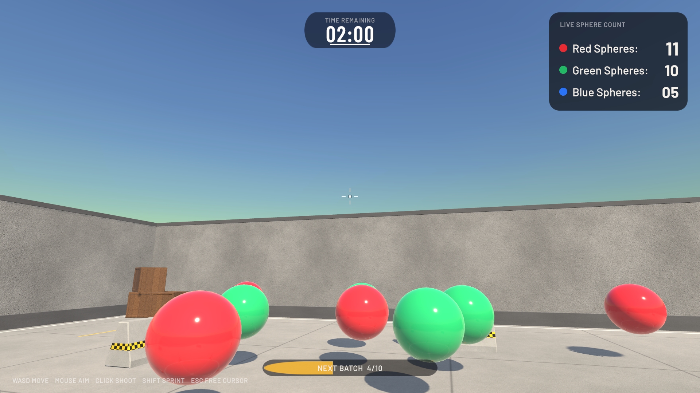

# Chroma Strike

A first-person sphere-targeting game built in Unity. Move around a flat arena, aim with the mouse, and pop color-coded spheres during a 120-second round. The live counters show the spheres remaining, not the cumulative number destroyed.

## Status

Unity verification: **7 EditMode tests + 5 PlayMode gameplay tests passed**, and the screenshot walkthrough passed. The Windows player builds with **zero errors and zero warnings**. See [feature coverage](Docs/REQUIREMENTS.md), [validation report](Docs/VALIDATION.md), and [testing instructions](Docs/TESTING.md).

## Requirements

- Unity **6000.6.7f1** with Windows Build Support, recorded in `ProjectSettings/ProjectVersion.txt`.
- An activated Unity Editor license.
- Internet access on first import to restore registry packages.

## Open and play

1. Unity Hub > **Add project from disk** > select this folder (the one containing `Assets`, `Packages`, and `ProjectSettings`).
2. Allow packages to restore, then open `Assets/Scenes/Game.unity`.
3. Press **Play** and select **Start Game**. Click the Game view if input focus is elsewhere.

### Controls

- **WASD** move, **Mouse** aim, **Left Mouse** pop the sphere under the center reticle, **Shift** sprint.
- **Escape** releases the cursor. Click the game view to resume aiming. The countdown continues.
- At time-up, inspect the final red, green and blue counts. Select **Restart** for a fresh round or **Quit** to exit.

## Gameplay rules

- The start screen includes the game title and Start button.
- Starting creates exactly **30 spheres: 15 red, 10 green and 5 blue**.
- Spawn centers use **X/Z between -10 and 10, Y = 1**.
- Placement checks occupied sphere positions, player clearance and obstacle colliders. When crowded, requests wait for a free position instead of overlapping an existing object.
- Every **5 seconds**, one randomly chosen red, green or blue sphere is added and updates the live count.
- Every **10 destroyed spheres** immediately requests a replacement batch with the same color counts. For example, destroying 5 red, 2 green and 3 blue produces a 5-2-3 batch. The next group starts counting from zero.
- Left-click casts a ray from the camera center. A sphere is popped only when that ray hits it; obstacles can block shots.
- The timer is top-center and the live color counters are top-right.
- At **120 seconds**, shooting, movement, physics and spawn retries stop. The end screen shows final live counts and a Restart button.
- Restart resets the player, timer, counts and batch history and creates a fresh 15/10/5 distribution.

## Project structure and key classes

- `Core/GameManager`: starts/ends/restarts the round and coordinates input, timer, spawner and UI events.
- `Core/GameConfig`: Inspector-editable spawn bounds, initial mix, duration, intervals, movement and shooting settings.
- `Core/CountdownTimer`, `RepeatingTimer`: deterministic countdown and recurring event timing, including long-frame catch-up.
- `Spheres/SpawnerManager`: initial, timed and conditional spawning; live/destroyed counts; queued placement retries.
- `Spheres/SpawnPointFinder`: random placement and sphere/player/obstacle clearance checks.
- `Spheres/BatchTracker`, `ColorTally`, `SphereColor`: destroyed color accounting and batch composition.
- `Spheres/Sphere`: sphere appearance, hover and destruction feedback.
- `Player/PlayerInputReader`, `FirstPersonController`: Input System actions, movement and mouse look.
- `Player/ClickHandler`, `CursorController`: center-ray selection and cursor ownership.
- `UI/UIManager`, `CounterRow`, `TimerView`, `BatchProgressView`, `ToastView`: menu/HUD/results and feedback.
- `Feedback/AudioService`, `FeedbackController`, `PopEffectPlayer`: sounds and pop particles.
- `Editor/SceneBuilder`, `BuildCommands`, `ProjectSetup`: scene construction, player settings and Windows build.

Game balancing is configured in `Assets/Settings/GameConfig.asset`. UI layouts and generated environment geometry are in the scene builder. Runtime scripts are separated by responsibility and communicate using events where appropriate.

## Unity and packages

- Input System **1.20.1**.
- Universal Render Pipeline **17.6.0**.
- uGUI / TextMesh Pro **2.0.0**.
- Unity Test Framework **1.4.6**.

`Packages/manifest.json` and `packages-lock.json` record dependencies. The build uses the new Input System.

## Build

Run `Tools/Run-Checks.ps1` to run the Unity checks and build the Windows player, or use **Chroma Strike > 3. Build Windows Player** in the editor. Output is `Builds/Windows/Chroma Strike.exe`.

Build output, installers and the local `Library` cache are not tracked; see `.gitignore`.

## Screenshots

Screenshots are captured from the current scene.

## Known limitations

- Dense placement can temporarily queue spawns until clearance is available; it never intentionally overlaps a sphere/player to force a spawn.
- No measured frame-rate or universal hardware compatibility guarantee is made.

## Documentation

- `Docs/REQUIREMENTS.md` - feature coverage
- `Docs/VALIDATION.md` - validation report
- `Docs/TESTING.md` - repeatable testing steps
- `Docs/ChromaStrike_Gameplay.mp4` - 68-second gameplay recording
